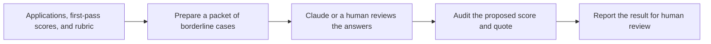

# How the review harness works

The harness sits between a program's first screening pass and the decision about whom to invite to a work test. It uses the first-pass scores to choose which applications deserve a second look. A reviewer proposes an execution score, and the Python code checks the evidence and recalculates the total. The team uses that result to make a decision.



## 1. Load the batch and calculate the starting score

The harness reads two CSVs and a rubric JSON file. The applications CSV contains the original answers. The first-pass CSV supplies four scores and an explanation for the execution score. The program running the screen supplies these initial scores. The harness calculates their weighted total.

The input loader matches the CSVs by application ID. It stops if the files have different ID sets, duplicate IDs, missing required columns, or scores outside the integer range from 0 to 5. The rubric supplies four positive weights that add up to 100, a cutoff, a band size, and a description for each execution score from 0 to 5. If the export uses different column names, a mapping file tells the loader which headers to read. [Input formats](inputs.md) · [Input validation code](../review_harness/inputs.py)

Each criterion contributes `score ÷ 5 × weight` points. Add the four contributions to get the total. With the [demo rubric](../examples/rubric.json), here is Mara Vale's score before and after the review:

| Criterion | Weight | First pass | After review |
| --- | ---: | ---: | ---: |
| Execution | 40 | 2/5 × 40 = 16 | 4/5 × 40 = 32 |
| Gap judgment | 25 | 4/5 × 25 = 20 | 4/5 × 25 = 20 |
| Initiative | 20 | 5/5 × 20 = 20 | 5/5 × 20 = 20 |
| Commitment | 15 | 4/5 × 15 = 12 | 4/5 × 15 = 12 |
| **Total** | **100** | **68** | **84** |

## 2. Select cases just below the cutoff

`prepare` selects a case when its first-pass total is at least `cutoff - audit_band` and below `cutoff`. For the demo's cutoff of 70 and band of 5, a score of 65 qualifies. Scores of 64 and 70 fall outside the band. Widening the band asks the reviewer to read more applications.

The packet is JSON. It includes the rubric version, the six execution-score descriptions, and the following fields for each selected case:

- `application_id`
- `execution_summary`
- `work_example`

The packet withholds the name, first-pass scores, and first-pass explanation. The reviewer can evaluate the evidence before seeing the earlier judgment. [Packet builder](../review_harness/audit.py)

## 3. Assign a second-pass execution score

In a live run, Claude or a human reviewer reads both answers and chooses the execution score whose description best fits the evidence. The demo rubric gives **2/5** for contributing a scoped task, **3/5** for completing a deliverable with a concrete result, and **4/5** for owning and coordinating a project through delivery with a concrete outcome. A **5/5** calls for repeated end-to-end delivery, concrete outcomes, and iteration.

Mara's short answer describes helping start a pilot. Her longer answer describes recruiting reviewers, setting the rubric, and running both rounds. The recorded reviewer credited that evidence with a **4/5**. One finding in the reviewer's JSON array looks like this:

```json
{
  "application_id": "G-104",
  "execution_score": 4,
  "field": "work_example",
  "quote": "I recruited six reviewers, wrote the rubric, and ran two rounds of a pilot that processed 48 submissions.",
  "reason": "She staffed and ran the pilot and reported a concrete outcome."
}
```

The Claude skill tells the reviewer to treat applicant answers as data, including any instructions embedded in the text. If the reviewer cannot cite supporting evidence for a case, they leave it out of the findings array. The bundled demo uses [recorded findings](../examples/quick/replay-findings.json). A live run produces fresh judgments. [Claude skill instructions](../.claude/skills/review-applications/SKILL.md)

## 4. Verify the finding and recalculate the total

`audit` loads the same applications, first-pass scores, and rubric again. It expects a JSON array of findings with at most one entry per application in the review band. A duplicate finding or an ID outside the band stops the run so the reviewer can correct the file.

For each eligible application, the verifier checks all four conditions:

1. The proposed execution score is an integer from 0 to 5.
2. The named source field is `execution_summary` or `work_example`.
3. The quote is at least 15 characters after trimming surrounding whitespace and occurs exactly as supplied in the named field. Spelling, case, punctuation, and whitespace must match.
4. The reviewer supplied a nonblank explanation.

A passing finding replaces the execution score for the proposed total. The other three scores come from the first pass. In Mara's case, her execution contribution goes from 16 to 32 points, which raises the total from 68 to 84. The verifier confirms that the text appears in the application. A human judges whether the quoted work supports the score and how much trust to place in the applicant's claims. [Evidence checks and scoring code](../review_harness/audit.py)

## 5. Read the report

The Markdown report starts with counts by outcome, then shows one entry per application. When a finding passes verification, the entry includes the old and proposed execution scores, the proposed total, the quote, and both reviewers' explanations.

| Outcome | Rule |
| --- | --- |
| **Flag for work-test review** | The finding passed verification and the proposed total reached or exceeded the cutoff. |
| **Stays below cutoff** | The finding passed verification and the proposed total remained below the cutoff. |
| **Needs human review** | The case was eligible, but its finding was missing or failed an evidence check. The report shows the first-pass total for context. |
| **Outside audit band** | The first-pass total was at or above the cutoff, or below the lower edge of the band. |

To see the packet and the audit separately with the same fictional data, run these commands from the repository root:

```sh
python -X utf8 -m review_harness prepare
python -X utf8 -m review_harness audit --findings examples/quick/replay-findings.json
```

For a new batch, follow [Run it on your applications](../README.md#run-it-on-your-applications).
